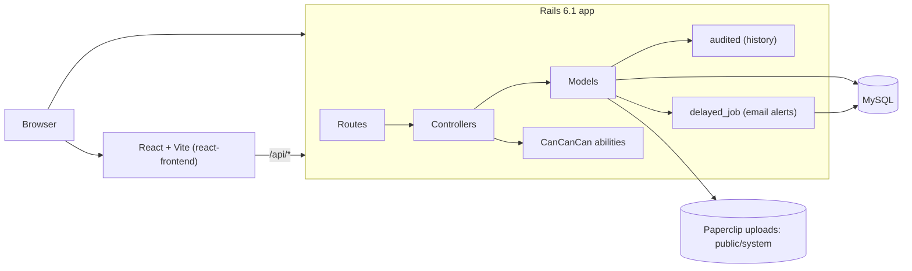

# Sprint Tracker

A multi-tenant, Jira-style agile project management app. Companies sign up under their own subdomain and manage projects, sprints and issues, log time against work, and review sprint reports and change history.


## Features

- **Projects**: per-company projects with a manager, members (`ProjectsUser`), an active sprint and a backlog.
- **Sprints**: planning, start and complete flows (`PLANNING` / `ACTIVE` / `CLOSED`), sprint reports and attachments.
- **Issues**: status, priority, category, assignee, reviewer, estimates and dates; issues move between backlog and sprints; email alerts on change (delayed_job).
- **History**: field-level audit trail of issue changes via `audited` (`/history`).
- **Time logs**: log time against issues; totals roll up to sprints and projects.
- **Multitenancy**: every model is scoped to a `Company` (selected by subdomain) unless it declares `not_multitenant`.
- **Auth and roles**: Devise (with confirmable) and CanCanCan abilities.
- **Documents**: Paperclip attachments on sprints and issues.
- **Reports**: sprint and issue reports.
- **React frontend** (`react-frontend/`): Vite app using the JSON API at `/api/projects`, `/api/issues`, `/api/sprints`, `/api/me`.

> Comments and watchers exist only on separate feature branches (`feature/comments`, `feature/watchers`) and are not part of `develop`.

## Architecture



Core models: `Company` has many `User`, `Project`, `Sprint`, `Issue`; `Project` has many `Sprint` and `Issue`; `Issue` has many `TimeLog` and `Document`.

## Setup

Requirements: Ruby 3.1.4, MySQL, Node 20+ (for the React app).

```sh
bundle install
# configure credentials in config/database.yml
bin/rails db:create db:schema:load db:seed
bin/rails server

# background jobs (email alerts)
bin/delayed_job start

# React frontend
cd react-frontend
npm ci
npm run dev
```

Tenants are resolved by subdomain, so use e.g. `acme.localhost:3000`.

Run the tests with `bundle exec rails test`.

## Tech stack

Ruby 3.1.4, Rails 6.1, MySQL (mysql2), Devise, CanCanCan, audited, delayed_job, Paperclip, Searchkick, React 19, TypeScript, Vite, Tailwind CSS.

## License

MIT. See [LICENSE](LICENSE).
